  

  
  
  

<h3 align="center">I turn messy data into decisions, and decisions into software people actually use.</h3>

 

  

 

## 🔥 Featured work

<table>
<tr>
<td width="50%" valign="top">

### 🧮 [Customer Lifetime Value](https://github.com/Karma1028/CLV_IBM-project) &nbsp;`live`
**What is a customer truly worth?** 9,134 customers, 24 variables, XGBoost prediction and segmentation, told as a detective story with a CLV predictor you can play with.

`Python` `XGBoost` `scikit-learn` `Plotly`
**[▶ Open the live story](https://unique-rugelach-c75c88.netlify.app/)**

</td>
<td width="50%" valign="top">

### 🏆 Case-competition engine &nbsp;`private`
Autonomous analysis-to-deck pipeline: HTML-first design, native PowerPoint export, fidelity gates and an improve loop. Demo on request.

`Python` `LLM agents` `PPTX`

</td>
</tr>
<tr>
<td width="50%" valign="top">

### 🧠 [KARMA-OS](https://github.com/Karma1028/Karma-OS)
My personal AI operating system, as a 10-view dashboard: fitness load, knowledge vault, memory layers, agent delegation graph and a correlation lab across my own data.

`React` `Vite` `D3` `Zustand`

</td>
<td width="50%" valign="top">

### 📈 [Stock Market Alchemist](https://github.com/Karma1028/Stock_App) &nbsp;`live`
Agentic stock-analysis app with ML models, sentiment data, and a full written research report on Tata Motors.

`Python` `Streamlit` `scikit-learn` `yfinance`
**[▶ Project page](https://karma1028.github.io/Stock_App/)**

</td>
</tr>
<tr>
<td width="50%" valign="top">

### 📻 [Hostel Vibes Radio](https://github.com/Karma1028/hostel-vibes-radio)
An always-on "radio" for Indian hostel life. Each room swaps the whole scene and soundtrack, with Hinglish one-liners and a live "log jaag rahe hain" presence counter.

`TypeScript` `Supabase Realtime` `Spotify embeds`

</td>
<td width="50%" valign="top">

### 🪞 [Portfolio](https://github.com/Karma1028/portfolio-online)
A production-style portfolio: profile, journey, skills, projects and contact, with Framer Motion animation.

`React` `TypeScript` `Tailwind` `shadcn/ui`

</td>
</tr>
</table>

Client and employer work stays private. Happy to walk through architecture and results in an interview.

 

## 🛠️ How I work

<b>raw data</b> &nbsp;→&nbsp; <b>clean + test</b> &nbsp;→&nbsp; <b>model / segment</b> &nbsp;→&nbsp; <b>interactive story</b> &nbsp;→&nbsp; <b>decision</b>

- **Statistics first.** Significance tests and honest segment definitions before any chart.
- **Ship it as a product.** If a stakeholder can't click it, it isn't finished.
- **Agents as leverage.** I wire LLMs (Groq, Gemini, OpenRouter) into analysis workflows, with the human still deciding.

 

## 🧰 Toolbox

  

  
  
  
  
  
  
  
  
  
  
  
  

 

## 🌱 Recent activity

  

 

## 📬 Let's talk

I'm looking for **data analyst, analytics engineering and AI engineering** roles and internships.
The fastest way to reach me is **[tuhin.gim@gmail.com](mailto:tuhin.gim@gmail.com)**. I reply.

Charts above regenerate daily from my GitHub data. No third-party widgets.

