

  

<h3 align="center">I find the story hiding in the data, then build the thing that lets people see it.</h3>

  
  
  

  

<b>ACTIVITY</b>

  
  
  
  

<b>WORK IN NUMBERS</b>

  
  
  
  

---

## 🚀 What I've built

  <a href="https://github.com/Karma1028/CLV_IBM-project"></a>
  <a href="https://github.com/Karma1028/Stock_App"></a>
  <a href="https://github.com/Karma1028/Karma-OS"></a>
  <a href="https://github.com/Karma1028/hostel-vibes-radio"></a>
  
  

Cards link to the repos. The bottom row is private. Client and employer work stays private too, and I'm happy to walk through the thinking in an interview.

---

## 🧭 Build log

  

---

## 🧠 How I think

| Principle | What it looks like in practice |
|---|---|
| **Say the uncertainty out loud** | 55% accuracy is reported as 55%. A $3.4M projection is labelled a projection. |
| **Kill leakage before tuning** | I drop the columns that give the answer away *first*, then see how good the model really is. |
| **If they can't click it, it isn't finished** | Every analysis ends as an app or a story a non-technical reader can use. |
| **Agents are leverage, humans decide** | I wire LLMs into analysis workflows to speed up the boring parts, and keep a person on the call. |

---

## 🧰 Toolbox

  

  
  
  
  
  
  
  
  
  
  
  
  
  
  

---

## 🌱 Recent activity

  

Most of my work lives in private repos, so this shows public activity only.

---

## 🎯 Right now

- **Building:** a case-competition engine that turns a messy brief into a defended deck, and a crew of agents that makes short videos.
- **Going deeper on:** uncertainty in forecasting (MC-dropout, GARCH) and statistical testing for business segments.
- **Looking for:** a **data analyst, analytics engineering or AI engineering** role where the work ends in a decision someone actually makes.

### 💬 Ask me about
`avoiding data leakage` · `why 55% accuracy can still matter` · `LSTM uncertainty with MC-dropout` · `turning models into customer segments` · `wiring LLM agents into analysis workflows`

---

<h3 align="center">Let's talk 📬</h3>

  <a href="mailto:tuhin.gim@gmail.com"><b>tuhin.gim@gmail.com</b></a> 
  I reply. Charts above regenerate daily from my GitHub data, no third-party widgets.

